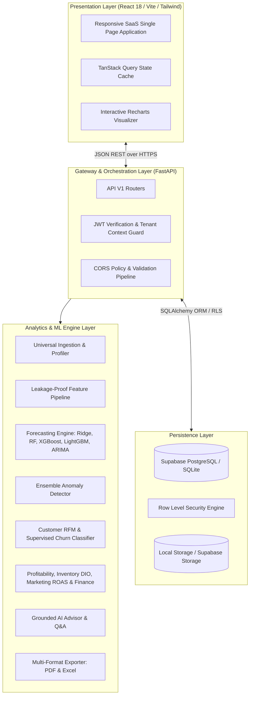

# NexoraIQ System Architecture & Engineering Design

## 1. Architectural Philosophy
NexoraIQ is engineered as a cloud-native, multi-tenant Business Intelligence and Predictive Analytics SaaS platform. It transitions legacy monolithic scripting into a decoupled, horizontally scalable architecture.



## 2. Multi-Tenancy & Security
- **Tenant Hierarchy:** User Profile &rarr; Organization &rarr; Workspaces &rarr; Business Datasets.
- **Tenant Isolation:** Every dataset, forecast, anomaly record, and recommendation is partitioned by `organization_id` and `workspace_id`.
- **Database Row Level Security (RLS):** Supabase PostgreSQL policies enforce access controls based on the authenticated JWT subject (`auth.uid()`).
- **Cryptographic Standards:** Bcrypt password hashing (cost factor 12) with raw SHA-256 fallback protection, signed HS256 JWT tokens.

## 3. Data Processing Workflow
```
Raw Business File (CSV/Excel)
       ↓
Universal Parser & Semantic Mapper (Regex + Dtype Inference)
       ↓
Data Quality Scoring (Completeness, Uniqueness, Validity, Consistency)
       ↓
Chronological Partitioning (70% Train, 15% Val, 15% Test)
       ↓
Leakage-Free Feature Transformation (Lags, Rolling Averages, Cyclical Transforms)
       ↓
Multi-Model Candidate Training & Walk-Forward Validation
       ↓
Model Selection via Lowest Validation RMSE
       ↓
Final Evaluation on Untouched Out-of-Sample Test Set
       ↓
Recursive Forward Forecasting + 95% Confidence Interval Envelopes
       ↓
AI Decision Advisor Synthesis & Strategic Action Feed
```

